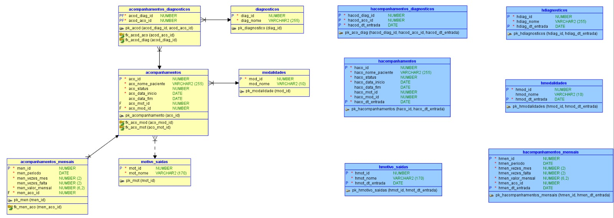

# Data Driven — Clínica de Psicologia

Projeto acadêmico de Banco de Dados e Business Intelligence desenvolvido com o objetivo de estruturar, armazenar, historizar e analisar informações de uma clínica de psicologia, transformando dados operacionais em informações estratégicas para a tomada de decisões.

A solução contempla desde a modelagem de um banco de dados relacional até a construção de consultas analíticas, mecanismos de auditoria, views de integração e dashboards interativos.

---

## Objetivo do Projeto

Desenvolver uma solução orientada a dados para uma clínica de psicologia, permitindo acompanhar informações relacionadas aos pacientes, atendimentos, diagnósticos, modalidades de atendimento, motivos de encerramento e movimentações financeiras.

O projeto busca responder perguntas importantes para a gestão da clínica, como:

- Qual é o faturamento ao longo dos anos?
- Quais são os diagnósticos mais recorrentes?
- Qual é o percentual de faltas dos pacientes?
- Quais são os motivos mais comuns de encerramento dos acompanhamentos?
- Qual é o tempo médio de permanência dos pacientes na clínica?
- Como os atendimentos se distribuem entre as modalidades presencial, online e híbrida?
- Como os indicadores evoluem ao longo do tempo?

Para isso, foi desenvolvida uma estrutura capaz de preservar informações históricas e disponibilizar dados consolidados para análises gerenciais.

---

## Tecnologias e Ferramentas

### Banco de Dados

| Tecnologia | Utilização |
|---|---|
| Oracle Database 12c | Gerenciamento e armazenamento do banco de dados relacional. |
| SQL | Linguagem utilizada para criação, manipulação e consulta dos dados. |
| Oracle SQL Developer | Desenvolvimento, execução e gerenciamento dos scripts SQL. |
| Oracle SQL Developer Data Modeler 19.4 | Modelagem conceitual e relacional do banco de dados. |
| SQL*Plus | Execução de comandos e scripts SQL diretamente no ambiente Oracle. |

### Business Intelligence e Documentação

| Tecnologia | Utilização |
|---|---|
| Microsoft Power BI | Construção de dashboards e visualização de indicadores. |
| CSV | Armazenamento e disponibilização de conjuntos de dados. |
| Microsoft Excel | Organização e documentação do dicionário de dados. |
| PDF | Documentação técnica e representação do dicionário de dados. |
| Git | Controle de versão dos arquivos e scripts. |
| GitHub | Hospedagem do projeto e colaboração entre integrantes. |

---

## Arquitetura e Estrutura do Projeto

O projeto foi organizado em módulos para separar as responsabilidades de criação do banco, povoamento, consultas analíticas e disponibilização dos dados para Business Intelligence.

```text
Data-Driven-Clinica-de-Psicologia/
│
├── bi/
│   ├── 01_criar_usuario_bi.sql
│   ├── 02_criar_views.sql
│   ├── 03_conceder_permissoes_bi.sql
│   ├── 04_testar_views.sql
│   │
│   ├── materialized/
│   │   ├── mv_atendimentos.sql
│   │   ├── mv_diagnosticos_perfil.sql
│   │   ├── mv_financeiro.sql
│   │   └── mv_pacientes_cadastrados
│   │
│   ├── atendimentos.csv
│   ├── diagnostico_perfil.csv
│   ├── financeiro.csv
│   ├── pacientes_cadastrados.csv
│   └── dashboard_financeiro.pbix
│
├── carga1_commits/
│   └── carga_1.sql
│
├── carga2_commits/
│   └── carga_2.sql
│
├── carga3_commits/
│   └── carga_3.sql
│
├── consultas/
│   └── consulta-set.sql
│
├── criacao_banco/
│   ├── clinica_banco.ddl
│   ├── criacao_auditoria
│   └── usuarios.sql
│
├── dicionario_de_dados/
│   ├── Dicionario_de_Dados.pdf
│   └── dicionario.xlsx
│
├── Modelo_Relacional_Historicos.jpeg
│
└── README.md
```

---

## Modelagem do Banco de Dados

O banco de dados foi desenvolvido utilizando o Oracle Database, com estrutura relacional e organização das entidades por meio de chaves primárias e estrangeiras.

A modelagem contempla informações sobre:

- Pacientes e acompanhamentos.
- Acompanhamentos mensais.
- Diagnósticos.
- Modalidades de atendimento.
- Motivos de encerramento.
- Registros históricos.
- Relacionamentos entre acompanhamentos e diagnósticos.

A estrutura utiliza relacionamentos entre entidades para reduzir redundâncias e garantir maior consistência dos dados.

### Modelo Relacional

O modelo contempla tanto as entidades operacionais quanto suas respectivas estruturas históricas.



---

## Versionamento e Histórico de Dados

Um dos principais diferenciais do projeto é a implementação de estruturas para preservar informações históricas.

Além das tabelas operacionais, foram desenvolvidas tabelas específicas para armazenar versões anteriores dos registros.

Essa abordagem permite acompanhar a evolução dos dados ao longo do tempo, evitando que alterações realizadas nos registros atuais eliminem informações importantes para análises retrospectivas.

Entre as estruturas históricas estão:

- `HACOMPANHAMENTOS`
- `HACOMPANHAMENTOS_MENSAIS`
- `HDIAGNOSTICOS`
- `HMODALIDADES`
- `HMOTIVO_SAIDAS`

As tabelas históricas possuem campos de controle temporal, como datas de entrada das versões, permitindo identificar diferentes estados dos registros.

### Consolidação de Dados Atuais e Históricos

Para garantir que as análises contemplem todo o período disponível, foram desenvolvidas consultas e views que integram os registros atuais e históricos.

Essa consolidação utiliza recursos como:

- `UNION ALL`;
- Common Table Expressions (CTEs);
- `ROW_NUMBER()`;
- `PARTITION BY`;
- `LEFT JOIN`;
- `FULL OUTER JOIN`;
- Funções de agregação.

A lógica de consolidação considera as versões dos registros para evitar duplicidades e preservar a consistência das informações analisadas.

---

## Sistema de Auditoria

O projeto também contempla um mecanismo de auditoria para acompanhar operações realizadas nas tabelas históricas.

A estrutura de auditoria registra informações relevantes sobre alterações e exclusões, permitindo rastrear modificações realizadas no banco de dados.

Foram utilizados recursos do Oracle Database, incluindo:

- **Sequences:** geração automática de identificadores para os registros de auditoria.
- **Triggers:** execução automática de rotinas durante operações de atualização e exclusão.
- **Procedures:** centralização da lógica de inserção dos registros de auditoria.
- **SYS_CONTEXT:** identificação do usuário conectado ao banco e do usuário do sistema operacional.

A estrutura registra informações como:

- Tabela afetada.
- Coluna modificada.
- Valor anterior.
- Novo valor.
- Tipo de operação (UPDATE ou DELETE).
- Data e horário da operação.
- Usuário do banco de dados.
- Usuário do sistema operacional.

O objetivo é proporcionar maior rastreabilidade e transparência sobre as modificações realizadas nos registros históricos.

---

## Consultas SQL e Análises

Foram desenvolvidas consultas SQL para extrair indicadores relevantes para a gestão da clínica.

As consultas utilizam recursos intermediários e avançados do Oracle SQL, incluindo funções de agregação, subconsultas, CTEs e funções analíticas.

### Indicadores desenvolvidos

**1. Análise de faltas**

Identificação do percentual de faltas dos pacientes ao longo dos períodos, considerando os registros mensais e históricos.

**2. Análise financeira**

Apuração dos valores recebidos ao longo do tempo, permitindo acompanhar o faturamento e a evolução financeira.

**3. Análise de diagnósticos**

Identificação dos diagnósticos associados aos acompanhamentos encerrados, permitindo analisar os motivos de alta por diagnóstico.

**4. Tempo de permanência**

Análise do tempo de permanência dos pacientes na clínica, considerando diferentes diagnósticos e motivos de encerramento.

**5. Análise por modalidade**

Acompanhamento do volume de encerramentos e do tempo médio de permanência nas modalidades presencial, online e híbrida.

**6. Motivos de encerramento**

Identificação dos principais motivos de saída dos pacientes, permitindo compreender os padrões de encerramento dos acompanhamentos.

---

## Business Intelligence — Power BI

A camada de Business Intelligence foi desenvolvida para disponibilizar informações estruturadas e facilitar a interpretação dos dados.

Foi utilizado o Microsoft Power BI para construção de um dashboard interativo, com integração aos dados preparados no Oracle Database.

### Views para consumo analítico

Foram desenvolvidas views específicas para disponibilizar os dados ao ambiente de BI:

- `VW_ATENDIMENTOS`
- `VW_DIAGNOSTICO_PERFIL`
- `VW_FINANCEIRO`
- `VW_PACIENTES_CADASTRADOS`

Essas estruturas organizam os dados e disponibilizam informações consolidadas para utilização nas análises.

### Views Materializadas

Também foram implementadas estruturas de views materializadas para apoiar a disponibilização de dados analíticos:

- `MV_ATENDIMENTOS`
- `MV_DIAGNOSTICOS_PERFIL`
- `MV_FINANCEIRO`
- `MV_PACIENTES_CADASTRADOS`

As views materializadas permitem armazenar resultados de consultas previamente executadas, contribuindo para otimizar o acesso a conjuntos de dados utilizados frequentemente.

### Dashboard

O repositório disponibiliza o arquivo:

`bi/dashboard_financeiro.pbix`

Esse arquivo contém o projeto desenvolvido no Power BI.

---

## Organização e Documentação dos Dados

Para facilitar a compreensão da estrutura do banco de dados, foram disponibilizados materiais de documentação:

**Dicionário de Dados — Excel**

Arquivo `dicionario.xlsx`, utilizado para documentar os elementos e atributos do banco de dados.

**Dicionário de Dados — PDF**

Arquivo `Dicionario_de_Dados.pdf`, disponibilizado para consulta e documentação técnica.

Esses materiais auxiliam na compreensão das entidades, atributos e relacionamentos utilizados no projeto.

---

## Como Executar o Projeto

Para reproduzir o ambiente, é necessário possuir:

- Oracle Database 12c ou ambiente compatível.
- Oracle SQL Developer.
- Acesso ao SQL*Plus (opcional, para execução por linha de comando).
- Microsoft Power BI Desktop para visualizar e editar o dashboard.

### 1. Criação do Banco

Execute o script:

```text
criacao_banco/clinica_banco.ddl
```

Ele contém a definição das estruturas relacionais, tabelas, chaves e relacionamentos.

### 2. Configuração dos Usuários

Execute os scripts de configuração de usuários e permissões conforme a organização dos schemas:

```text
criacao_banco/usuarios.sql
```

### 3. Povoamento do Banco

Execute as cargas de dados na ordem indicada:

```text
1. carga1_commits/carga_1.sql
2. carga2_commits/carga_2.sql
3. carga3_commits/carga_3.sql
```

**Importante:** as cargas foram estruturadas para execução sequencial em um banco preparado para o povoamento inicial. A ordem dos INSERTs e a geração dos identificadores devem ser preservadas para manter a integridade dos relacionamentos.

### 4. Configuração da Auditoria

Execute o script:

```text
criacao_banco/criacao_auditoria
```

Esse script configura os objetos responsáveis pelo registro das operações de auditoria.

### 5. Criação das Estruturas de BI

Execute os scripts disponíveis no diretório:

```text
bi/
```

A configuração contempla a criação do usuário de BI, das views, concessão de permissões e testes de funcionamento.

As views materializadas também estão documentadas no subdiretório `bi/materialized/`.

### 6. Execução das Consultas

As consultas analíticas desenvolvidas pelos integrantes estão disponíveis em:

```text
consultas/consulta-set.sql
```

### 7. Visualização do Dashboard

Abra o arquivo:

```text
bi/dashboard_financeiro.pbix
```

Utilize o Power BI Desktop para visualizar o dashboard.

Caso seja necessário conectar o arquivo a outra instância do Oracle Database, ajuste as configurações de conexão e atualização das fontes de dados.

---

## Integrantes do Projeto

Projeto desenvolvido em equipe por:

| Integrante |
|---|
| **Diego Augusto** |
| **Rafael Prado** |
| **Pedro Cecheto** |
| **Matheus Massayuki** |

---

## Considerações Finais

O projeto Data Driven — Clínica de Psicologia demonstra a aplicação prática de conceitos de banco de dados relacionais, engenharia de dados e Business Intelligence em um cenário de gestão.

Ao integrar modelagem de dados, SQL, histórico de informações, auditoria e visualização analítica, a solução busca transformar registros operacionais em informações relevantes para o acompanhamento e a tomada de decisões.

Mais do que armazenar dados, o projeto demonstra como uma estrutura de dados bem planejada pode contribuir para uma gestão mais organizada, rastreável e orientada por informações.

---

## Repositório

**GitHub:**  
https://github.com/diego-dev-brazil/Data-Driven-Clinica-de-Psicologia

**Projeto:** Data Driven — Clínica de Psicologia

**Área:** Banco de Dados | SQL | Engenharia de Dados | Business Intelligence
